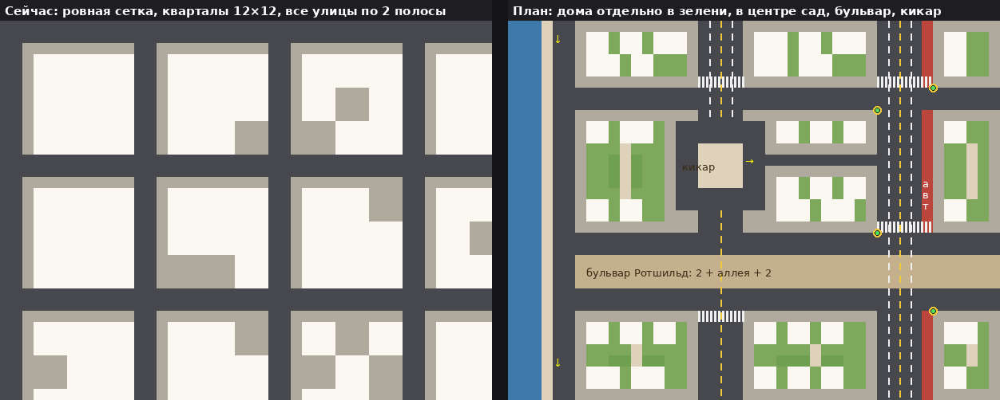

# План: карта и камера «как в GTA2», с израильским колоритом

Документ на согласование. Пока это только план, код не менялся.

## 1. Что изучено

* Формат карт GTA2 (документ DMA, v8.2): сетка блоков, уровни высоты, типы
  покрытия, стрелки трафика, перекрёстки, светофоры, зоны —
  [gtamp.com](https://gtamp.com/gta2/gta2-gmp-map-file-format/).
* Как в GTA2 строят дороги (модмейкеры) —
  [WikiGTA: Creating roads (GTA2)](https://en.wikigta.org/wiki/Creating_roads_(GTA2)),
  [здания](https://en.wikigta.org/wiki/Creating_buildings_(GTA2)).
* Полные карты трёх районов —
  [Grand Theft Wiki: Maps of GTA 2](https://www.grandtheftwiki.com/Category:Maps_of_GTA_2);
  карта Residential отрисована около 4 пикселей на блок, по ней мерил ширину улиц.
* Разбор сильных и слабых мест Downtown от игроков —
  [форум GTAMP](https://gtamp.com/forum/viewtopic.php?p=13639).
* Камера — [Grand Theft Wiki: Top-down Perspective](https://www.grandtheftwiki.com/Top-down_Perspective).
* Скриншот игры — [Wikipedia: Grand Theft Auto 2](https://en.wikipedia.org/wiki/Grand_Theft_Auto_2).
* Устройство районов — [StrategyWiki](https://strategywiki.org/wiki/Grand_Theft_Auto_2).

## 2. Как устроена GTA2

**Сетка.** Город — куб из блоков 256×256 по горизонтали и 8 уровней по
высоте; блок — 64 пикселя. Наша клетка тоже 64 — единица та же.

**Масштаб относительно дороги** (снят со скриншота):

| | GTA2 | У нас сейчас |
|---|---|---|
| Полоса движения | 1 блок | 1 клетка |
| Ширина машины | ~0,8 полосы | ~0,55 |
| Длина машины | ~1,7 полосы | ~1,0 |
| Пешеход | ~⅓ полосы | ~¼ |
| Видно пешком (640×480) | ~9 × 7 блоков | ~21 × 12 клеток (1080p) |

**Дороги.**
* Улицы разной ширины: переулки и обычные улицы — 2 полосы (1 + 1), проспекты —
  4 (2 + 2), местами шире. Тротуары 1–2 блока.
* Движение задаётся стрелками по блокам, перекрёстки собираются из них.
  Светофоры стоят на выбранных перекрёстках. Без светофора машина едет прямо,
  а не поворачивает.
* Рядом с дорогой оставляют место, чтобы объехать пробку.

**Кварталы.**
* Неровные: от 6 до 20 с лишним блоков, разной формы.
* Есть суперкварталы с внутренними дворами, проходами, тупиками, парковками.
* Дома неправильной формы (Г, П, с выступами), в центре кварталов — дворы.

**Высота.** Мосты, эстакады, пандусы, крыши, метро и поезд, туннели
(уровни высоты 1–6).

**Районы.**
* У каждого района своя палитра покрытий и свои приметы.
* Территории банд подписаны и закрашены — у нас это уже есть.
* Чего игроки не любят в Downtown: однообразный белый тротуар, пустые
  «моноблоки», запутанные петли дорог и мало ориентиров. Это учтём.

**Камера.** Строго сверху, с перспективой: стены домов видны по краям экрана.
* Пешком — ближе всего.
* В машине — выше, и поднимается ещё сильнее с ростом скорости.
* Точных чисел в источниках нет, поэтому ниже свои, подобранные под ощущение
  GTA2.

## 3. Главный принцип: Тель-Авив, а не Америка

GTA2 — американский город, и его кварталы американские. Из GTA2 берём только
то, как устроена **игра**: масштаб, камеру, читаемую иерархию улиц, дворы и
проходы как игровое пространство, детали перекрёстков. **Город** остаётся
тель-авивским: застройка, планировка и характер районов.

Чем Тель-Авив отличается (план Патрика Геддеса 1925 года и «Белый город»):

* **Главные улицы идут параллельно морю** (Ха-Яркон, Бен-Йехуда, Дизенгоф,
  Ибн-Гвироль). Поперечные — от моря вглубь, чтобы город продувал бриз.
* **Суперкварталы с общественным садом в центре.** К саду ведут тихие жилые
  улочки и тропинки; внутри детские площадки и сады. Тупиков Геддес избегал.
* **Дома стоят отдельно,** каждый на своём участке в зелени, и занимают не
  больше трети участка. Это белые кубики в 3–4 этажа, часто на сваях, с
  промежутками между домами. Сплошных стен домов, как в американском даунтауне,
  в Белом городе нет.
* **Бульвары** с аллеей посередине и **площади-кикары**.

Источники: [план Геддеса](https://en.wikipedia.org/wiki/Geddes_Plan_for_Tel_Aviv),
[ЮНЕСКО: Белый город](https://whc.unesco.org/en/list/1096/).

**Как устроен каждый район** (это сохраняем и усиливаем):

| Район | Планировка и застройка |
|---|---|
| Белый город (центр, Старый Север) | суперкварталы Геддеса, отдельные дома на сваях в зелени, сад в центре, бульвары |
| Флорентин | узкие улицы, сплошные фасады: мастерские внизу, квартиры с балконами сверху, переулки с граффити |
| Неве-Цедек | кривые узкие улочки, низкие дома под черепицей, дворики |
| Старый Яффо и Аджами | неровная восточная планировка, каменные дома, лестницы и пешеходные проулки, виллы у моря |
| Шук а-Кармель, а-Тиква, блошиный рынок | рыночные улицы, где ходят пешком, с рядами прилавков |
| Юг (у автостанции) | плотная смешанная застройка, проходные дворы, огромная автостанция |
| Шхунот | «шикуны» — длинные бетонные дома среди газонов |
| Рамат-Ган | башни на подиумах, широкие улицы, сады вокруг |
| Сарона, Кирья | парк с домами тамплиеров; закрытый военный городок |

## 4. План изменений

### Этап 1. Масштаб и камера

Быстро, и разница видна сразу.

* **Масштаб.**
  * Машины крупнее примерно в 1,55 раза: седан ≈ 52 × 102 вместо 34 × 66.
  * Люди крупнее в 1,25 раза.
  * Скорость, управление, столкновения, радиусы взрывов и дальность стрельбы
    подстроить под новый масштаб.
* **Камера.**
  * Пешком в кадре ≈ 9 клеток по высоте.
  * В стоящей машине ≈ 12 клеток; на максимальной скорости ≈ 20.
  * Подъём плавный, около секунды; спуск медленнее, около двух.
  * Камера смещается вперёд по ходу движения, до трети экрана: на скорости
    видно, куда едешь.
* **Вид.** По умолчанию строго сверху с перспективой, как в GTA2: стены видны у
  краёв экрана, высокие дома «наклоняются» от центра. Нынешний наклон, при
  котором видны фасады, остаётся на клавише V (см. вопрос 1).

### Этап 2. Новая сеть улиц

Тель-Авив по типам улиц:

| Тип | Полосы | Где |
|---|---|---|
| Шоссе Аялон | 3 + 3, посередине пути поезда, съезды | граница центра и Рамат-Гана |
| Проспект | 2 + 2 | Дизенгоф, Ибн-Гвироль, Алленби (с изгибом), Жаботински |
| Бульвар | 2 + аллея с деревьями и киосками + 2 | Ротшильд, Бен-Гурион, Хен |
| Обычная улица | 1 + 1 | большинство |
| Односторонняя | 1–2 полосы | Ха-Яркон, Бен-Йехуда, Флорентин |
| Переулок | 1 полоса, часто тупик | Флорентин, Неве-Цедек |
| Пешеходные | машинам нельзя | Старый Яффо, Шук, Нахалат Биньямин |

* **Кварталы** разного размера: суперкварталы Белого города 15–20 клеток,
  плотный Флорентин 6–8. В Яффо планировка неровная, в Рамат-Гане крупная.
  Т-образные перекрёстки есть, тупиков мало, как у Геддеса.
* **Круговые перекрёстки** («кикар»): площадь Дизенгоф, у часовой башни Яффо,
  в Рамат-Гане. Это очень по-израильски.
* **Разметка.**
  * Сплошные и пунктирные линии, стоп-линии, «зебры».
  * Красные автобусные полосы (נת״צ) и стоянки такси.
  * Красно-белые и сине-белые бордюры — они уже есть.
* **Светофоры** на крупных перекрёстках: жёлто-чёрные столбы, как в Израиле.
  Машины и пешеходы стоят на красный (см. вопрос 5).
* **ИИ трафика.** Едет по полосам, соблюдает одностороннее движение,
  перестраивается и объезжает. Полиция и погони ездят по новой сети.

### Этап 3. Кварталы и дворы

* **Белый город — по Геддесу.**
  * Отдельные дома в зелени с промежутками в клетку.
  * В центре суперквартала общественный сад с детской площадкой; к нему
    ведут тропинки и тихие жилые улочки (машина проедет, но медленно).
  * У домов парковка под сваями, мусорные контейнеры и клетки для бутылок,
    вход в бомбоубежище.
  * Через промежутки между домами и сады удобно уходить от погони —
    это и есть «дворы» в духе GTA2, только по-тель-авивски.
* **Сплошные фасады и внутренние дворы-колодцы** — только там, где они есть
  на самом деле: Флорентин, юг, часть Яффо.
* **Свой характер у каждого района.**
  * Белый город: дома на сваях с садом под ними.
  * Флорентин: мастерские, глухие переулки, граффити.
  * Яффо: узкие каменные пешеходные улочки и лестницы.
  * Юг: проходные дворы и рынок.
  * Рамат-Ган: башни на подиумах с подземными парковками.
* **Покрытия разные по районам**, чтобы не было «однообразного белого
  тротуара».
* **Больше мелочей.** Гидранты, киоски, банкоматы, автоматы с напитками,
  мусор, тележки, мопеды, кадки с цветами.

### Этап 4. Уровни высоты

Отдельное согласование: самая трудоёмкая часть.

* Мосты через Яркон и над Аялоном, эстакады и съезды.
* Крыши, на которые можно подняться по лестницам.
* Поезд вдоль Аялона.

Для этого нужна физика с высотой и поиск пути с учётом уровней.

### Этап 5. Перенос всего остального

* Места миссий, телефоны, магазины и тайники переставить на новую карту.
* Пути полиции и бандитов, такси и «Шмоне-Бис» — тоже.
* Миникарта, 2D-режим; прогон всех 16 миссий тестом.

## 5. Что не меняется

Районы и территории банд, достопримечательности, вывески, фасады,
сгенерированные картинки, сюжет, тексты, звуки. Израильский колорит —
главный приоритет: схема GTA2 только помогает ему.

## 6. Риски

* Это перестройка генератора города, трафика и всех точек миссий. Делать
  её стоит по этапам, проверяя каждый.
* Карта новая, поэтому старые сохранения начнут миссию с того же номера,
  но на новых местах.
* Больше мелких деталей — выше нагрузка. Буду следить за временем кадра,
  как раньше.

## 7. Вопросы на согласование

1. **Вид камеры.** Строго сверху с перспективой, как в GTA2 (фасады видны у
   краёв экрана), — или оставить нынешний наклон по умолчанию?
2. **Масштаб.** Делать машины и людей крупнее, как в GTA2?
3. **Уровни высоты** (этап 4: мосты, эстакады, крыши, поезд) — сейчас или
   отдельным заходом позже?
4. **Размер города.** Оставить около 132 × 130 клеток (с крупным масштабом и
   близкой камерой он будет ощущаться в 1,5–2 раза больше) или расширить?
5. **Светофоры.** Рабочие (трафик и пешеходы стоят на красный) или только
   для вида?
